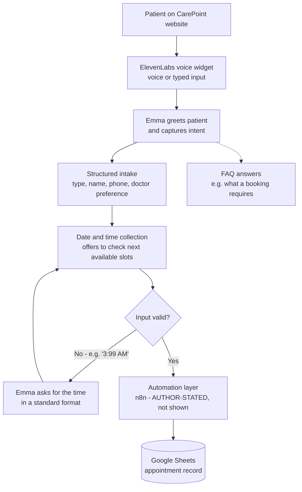

# Project Architecture — CarePoint AI Voice Receptionist

## Architecture Overview

The system has three evidenced layers and one author-stated layer:

| Layer | Component | Evidence |
|---|---|---|
| Patient interface | CarePoint Medical Clinic website with the embedded voice widget (voice + typed input, live transcript, call states) | ✅ Shown in video |
| Voice agent | ElevenLabs Voice Agent — "Emma", the clinic's virtual receptionist (greeting, structured intake, validation, FAQ answers) | ✅ Shown in video (widget labelled "ElevenLabs Voice Agent") |
| Automation | n8n workflow automation connecting the agent to the data store | ⚠️ **Author-stated** in the published caption — never shown in the video |
| Data store | Google Sheets appointment record: **Name \| Phone \| Appointment Type \| Date \| Time \| Doctor** | ✅ Shown in video (twice) |

## Data Flow

1. The patient starts a conversation from the website widget (voice, or typed fallback).
2. Emma runs a structured intake: appointment type → name → phone → date/time → optional doctor preference.
3. Emma validates what she hears; an invalid time ("3:99 AM") triggers a clarification request instead of a booking.
4. The validated booking is passed through the automation layer (n8n, author-stated).
5. A new row appears in the Google Sheets appointment record.
6. The same conversation channel also answers patient FAQs (e.g. what information a booking requires).

## Integration Overview

| Integration | Role | Status |
|---|---|---|
| ElevenLabs (voice agent platform) | Hosts "Emma"; provides the website widget, speech conversation, and transcript | ✅ Verified from video |
| Clinic website | Hosts the widget; presents services (Primary Care, Preventive Health, Family Medicine, Follow-up Care) and the Book Appointment entry point | ✅ Verified from video |
| Google Sheets | Appointment record / lightweight clinic register | ✅ Verified from video |
| n8n | Workflow automation between the agent and Sheets | ⚠️ Author-stated only — **Not confirmed from video** |
| LLM / speech models behind the agent | Conversation intelligence | ❌ Not named in the video — **Not confirmed from video** |
| Reminder channel (SMS/email/etc.) | Appointment reminders mentioned in the author's description | ❌ Not shown — **Not confirmed from video** |

## Mermaid Flowchart

## Design Notes (evidenced)

- **Validation before storage** is the standout design decision visible in the demo: the agent would rather ask again than write a bad time into the clinic's record.
- **One channel, two jobs:** the same widget conversation handles both transactions (booking) and information (FAQ), and the FAQ answer mirrors the intake field list exactly.
- **A spreadsheet as the system of record** keeps the clinic's data in a tool staff already know; the trade-offs of that choice (concurrency, privacy of patient data, no built-in double-booking protection) are discussed in [PROJECT-LIMITATIONS.md](PROJECT-LIMITATIONS.md).
